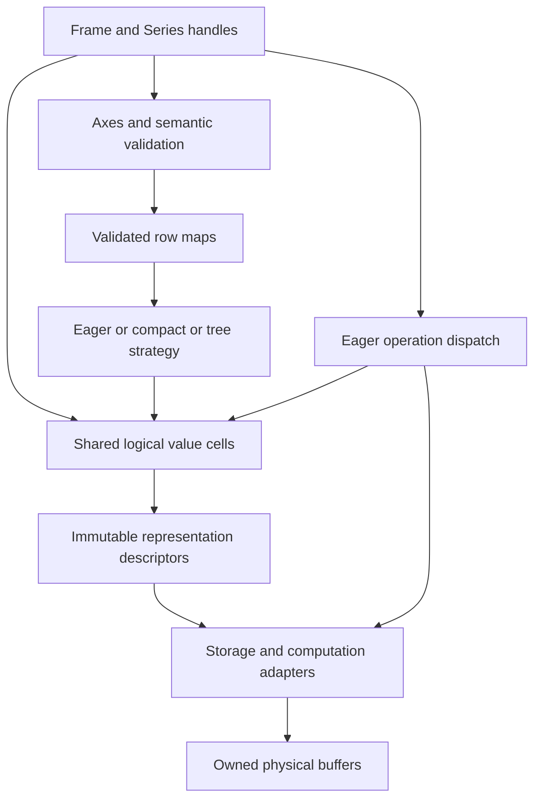

# Python prototype design for the pandas runtime

Date: 2026-11-12. Status: proposed implementation design. This document specifies the prototype; it does not claim that its code or performance results exist.

Build a standalone Python package inside this experiment, using NumPy and PyArrow for bulk operations. One API runs against three representation strategies: eager, compact, and tree. Start with selection, shared maps, eager arithmetic, and isolated mutation. Compare compact and tree strategies before committing to either architecture. Rust is reserved for a later, measured bottleneck. Design backend boundaries from the start and validate them with a narrow JAX adapter before expanding structural operations; NumPy and Arrow remain the first complete adapters.

The [review](review.md) explains the architectural risks. The [experimental plan](experiments.md) defines the broader evaluation. This design makes the first implementation concrete and narrows its initial semantic surface.

The [unified logical type design](logical_types.md), informed by the now-verified PDEP-13 draft, specifies canonical type identity and operation/result-type binding. This is a unified type layer with a small initial type set, rather than separate backend dtype systems with common names.

## The first complete experiment

The first usable milestone should support this entire sequence under all three strategies:

```python
rt = Runtime(strategy="compact")  # also "eager" and "tree"

df = rt.frame(
    {
        "price": rt.array([10, 20, 30], dtype="int64", backend="numpy"),
        "name": rt.array(["a", "b", "c"], dtype="utf8", backend="arrow"),
    },
    index=["x", "y", "z"],
)

selected = df.take([1, 1, 2])
short = selected.slice(slice(0, 2))
result = short.column("price").add(1)  # computation completes here
assert result.to_list() == [21, 21]

short.set_at(row=0, column="price", value=99)
assert short.column("price").to_list() == [99, 20]
assert selected.column("price").to_list() == [20, 20, 30]
assert df.column("price").to_list() == [10, 20, 30]

short.materialize()  # same values; resolve pending structural access
detached = short.compact()  # new frame, copied payloads, no source retention
```

This is an API sketch. Constructors, exceptions, and output comparisons will be executable tests in the implementation. The first performance workloads are selection followed by narrow consumption, repeated consumption, and full consumption. Do not make a fast `take()` call the success criterion by itself.

## Scope and compatibility

The first release of the experiment is a research API, not a pandas subclass or an ExtensionArray integration. Explicit methods avoid implementing the full indexing syntax before the representation model has been tested.

| Area | Initial contract | Later work |
| --- | --- | --- |
| Logical types | Nullable signed int64, nullable boolean, nullable UTF-8 string | Float semantics, smaller integers, timestamps, categoricals, nested and object types |
| Storage | NumPy values plus validity for integer/boolean; Arrow for all three types; experimental JAX integer/boolean adapter | NumPy string storage, Arrow string views as a measured alternative |
| Selection | Positional take, normalized slices, boolean filter, internal missing-aware take | Persistent boolean-map representation and adaptive selection policies |
| Axes | Ordered flat integer/string labels; duplicate rows allowed | MultiIndex and richer metadata |
| Columns | Unique string names, ordered slots | Duplicate column labels |
| Computation | Int64 scalar/pair addition, integer comparisons, string equality, integer sum | More operators and promotion |
| Mutation | Scalar positional update, scalar/vector assignment to unique positions, column replacement | Duplicate-destination vector assignment and optimized sparse updates |
| Structural methods | Stable single-key sort, unique-source reindex, same-schema concat, limited equijoin | General pandas merge/reindex options |
| Interoperability | Explicit NumPy/Arrow/pandas conversion and simple serialization | General automatic protocol integration |

All logical types admit a missing value, denoted `NA`. Missingness is not a backend property. NumPy uses a separate boolean validity array; Arrow uses its validity representation. A scalar read returns a Python scalar or the prototype's `NA` singleton. Reject floats, object values, and unsupported coercions at ingress in the first milestone. This avoids silently deciding the unresolved NaN/type-promotion questions while still testing heterogeneous storage and missing-aware composition.

Use pandas `Int64`, `boolean`, and `string` with `pd.NA` as the initial semantic oracle. Storage is explicit in the prototype and does not change its logical dtype. Canonical dtype objects contain only semantic identity; backend and encoding remain physical metadata. There is no automatic promotion: incompatible computation or assignment into an existing column raises before changing the object. Whole-column replacement may install a different supported logical dtype. Int64 arithmetic wraps modulo 2^64 and interprets the result as signed; out-of-range input scalars and assignment values raise. Scalar booleans are not accepted as integer positions or integer assignment values.

Integer addition and comparisons propagate missingness. String equality is exact, case-sensitive, and propagates missingness. Filtering treats missing boolean entries as false. `sum(skipna=True, min_count=0)` returns zero for an empty/all-missing input; insufficient valid entries or any missing value with `skipna=False` returns `NA`. The integer accumulator follows the wrapping contract.

Adapters must pass reduction options explicitly: Arrow's documented `sum` default uses `min_count=1`, whereas this API chooses zero. Its unchecked `add` documents wrapping overflow; NumPy documents modular integer summation. These are candidate native implementations, subject to conformance tests at pinned versions. [Arrow add](https://arrow.apache.org/docs/python/generated/pyarrow.compute.add.html), [Arrow sum](https://arrow.apache.org/docs/python/generated/pyarrow.compute.sum.html), [NumPy sum](https://numpy.org/doc/stable/reference/generated/numpy.sum.html).

Float64 is the next semantic extension, not a prerequisite for the first comparison. Specify NaN versus null, comparisons, scalar export, and reduction tolerances before enabling it; reserve the float workloads in the experimental plan until then.

## Component boundaries



The runtime chooses representation policy; backend adapters implement physical access and computation. Neither layer decides label alignment. The axis adapter resolves labels and returns row maps before positional computation begins.

### Runtime

`Runtime` owns the strategy, backend registry, deterministic execution policy, and optional metrics sink. It does not strongly retain every value or allocation. Avoid process-wide mutable configuration: two runtimes with different strategies must coexist in the same test.

Objects from different runtimes are rejected by binary operations unless explicitly imported. A runtime uses one strategy throughout a benchmark. All three strategies share constructors, validation, labels, kernel dispatch, export, and mutation code.

### Physical storage

`Storage` is an internal immutable view of a backend value: logical dtype, length, backend, device, physical encoding, and references sufficient to keep its buffers alive. A NumPy storage object has a one-dimensional typed values array and optional validity; Arrow storage has an Array or ChunkedArray of a supported type. Chunk layout belongs to storage. An experimental JAX storage object carries numeric values and optional boolean validity on the same device; it need not expose a host buffer or writable memory.

Physical storage may be strided or chunked. It must not contain a private structural selection node. Do not expose its writable buffers through the public API.

### Value cells and mutable handles

`ValueCell(dtype, length, state)` denotes an immutable logical sequence. Its internal state is either an immutable representation descriptor or an equivalent physical storage descriptor. A cell may replace its representation with a physical result, but may never change its logical values.

`Frame` holds axes and an ordered tuple of value-cell references. `Series` holds an axis, a name, and one value-cell reference. Selecting a column returns a new Series handle sharing the cell. Assigning into that Series replaces its cell reference; it does not update the parent Frame. Likewise, assigning into a Frame replaces only that Frame's target slot.

`Array` is the unlabeled handle returned by `Runtime.array`; it holds one value cell. Frame construction can share cells from Arrays belonging to the same Runtime because subsequent writes replace handle references. The constructor snapshots the mapping of names to cells and the axes, so later changes to the caller's dictionary or label sequence cannot alter the frame.

This separates semantic mutation from representation caching. Sharing a cell means sharing a value and any completed materialization. It does not mean sharing a writable object handle.

### Public method surface

```text
Runtime.array(values, *, dtype, backend, validity=None, device=None) -> Array
Runtime.frame(columns, *, index=None) -> Frame

Array / Series:
    take(indices), slice(slice_object), filter(boolean_array)
    scalar_at(position), add(scalar_or_peer), eq(scalar_or_peer)
    lt(scalar_or_peer)                         # integer only
    sum(skipna=True, min_count=0)              # integer only
    set_at(position, value)
    materialize(), compact(), to_list()

Frame:
    column(name), project(names)
    take(indices), slice(slice_object), filter(boolean_array)
    set_at(*, row, column, value)
    set_values(*, rows, column, values)
    replace_column(name, array)
    sort_values(name), reindex(labels)
    join(right, *, on, how, suffixes)
    materialize(), compact(), to_pandas()

Runtime.concat(frames) -> Frame
All handles: explain_representation(), memory_report()
Array / Series: to_numpy(), to_arrow()
Array / Series: to_backend(backend, *, device=None)
```

Structural methods return new handles. `set_at`, `set_values`, and `replace_column` mutate only the receiving handle and return `None`. `project` selects/reorders distinct existing names; repeated names raise until duplicate columns are supported. Filtering is explicitly positional; pass a prototype boolean Array or a validated boolean sequence, not an implicitly aligned pandas Series.

Use `IndexError` for positional bounds, `KeyError` for absent requested columns, `TypeError` for unsupported values/types/operations, and `ValueError` for shape mismatches, zero slice steps, and unsupported duplicate-axis cases. Error messages identify the unsupported contract rather than silently converting to pandas. Public conversion details are specified below.

## Maps and representations

### Row maps

Every map records `source_length` and `output_length` and maps output positions to source positions. Use frozen descriptors and private owned index buffers:

```text
Identity(n)
Affine(source_length, start, step, output_length)
Positions(source_length, positions, present=None)
```

`present=None` means every mapping exists. Otherwise it is a boolean array of output length in the map adapter's namespace/device. A false entry means an introduced missing position; its associated integer must never be dereferenced. Source validity stays in the source array and is combined when reading. Normalize missing index slots to zero for deterministic debugging, but do not rely on zero being in bounds for an empty source.

Public `take(indices)` uses ordinary negative positional indexing. Reindex uses an internal missing-aware constructor with an explicit presence mask. Never overload the internal meaning of `-1`. A boolean filter initially becomes positions using a native operation; retained masks are a later ablation.

Constructors validate rank, integer type, bounds, lengths, and slice step immediately, then take ownership of map data. Internally produced immutable maps can be reused. Representation rewrites run only after validation, so simplifying a constant cannot hide an invalid index.

Map composition is `compose(inner, outer)`, corresponding to `inner[outer]`. Validate `outer.source_length == inner.output_length`. The composition propagates missingness before reading either map. Two affine maps produce an affine map using composed offsets and strides. An arbitrary gather generally allocates an output-length position array and possibly a presence array.

For frame-wide operations, a short-lived `SelectionContext` memoizes composition by the identities of the immutable inner and outer maps. All columns sharing that pair reuse one composed result. Length equality alone is not permission to share a map: its positions must refer to the same logical row ordering. Callers establish that ordering through the frame operation. The context dies after the operation, so it cannot retain old frames globally.

### Representation vocabulary

```text
Physical(storage)
Select(source_cell, row_map)
Constant(typed_scalar, length)
Segments(child_cells, cumulative_lengths)  # second structural milestone
```

Descriptors are immutable, and references point only to already existing value cells. The value graph is acyclic. Shapes and logical types are known at construction. `Segments` requires a single resolved logical dtype; mixed physical backends may coexist only where materialization has an explicit destination policy.

The three strategies use the same vocabulary and semantic rules:

| Strategy | Creating a selection | Reading a selected value |
| --- | --- | --- |
| Eager | Execute selection and store `Physical` immediately | Read physical storage |
| Compact | Compose consecutive maps at creation; retain one selection above a physical or constant leaf | Apply the normalized map |
| Tree | Retain `Select(source_cell, map)` without composing the complete chain | Resolve only the requested positions through the chain |

Compact mode starts with no `Segments` support. When segments are added, their children must be normalized, and selection over a segmented source may materialize that source as a documented escape path. Measure this fallback explicitly against tree mode. Do not hide a second general mapping language inside the compact strategy.

Tree mode must not materialize each intermediate array when reading a descendant. Traverse an explicit stack and compose requested positions in bulk toward the leaf, then gather payloads once. Scalar reads can traverse scalar indices; vector reads use bulk map-adapter operations, not a Python loop over rows. NumPy implements the first map adapter; neither the descriptor algebra nor the traversal requires host-resident index arrays. A short-lived `ReadContext` memoizes resolution by the immutable map chain and requested selection, so columns traversing that same chain share the resolved map during a frame read. Keep those maps strongly alive until the read finishes, then release the context. There is no persistent map-resolution cache initially. Disable this memoization in an ablation.

Initially use the same cheap, validated rewrites in both deferred strategies: identity elimination, canonical typed empties, and total selection of a constant. Missing selection of a nonmissing constant retains validity. More aggressive composition is precisely the difference being measured. Representational depth and segmentation are observable metrics, not silent heuristics.

## Materialization and lifetime

There are two different internal operations:

```python
read(cell, row_map) -> Storage
ensure_physical(cell) -> Storage
```

`read` obtains only the requested logical positions and need not resolve the full parent cell. It can return a storage view where possible. It does not install a small partial read as the parent's complete cached result. A child cell can cache its own full result.

`ensure_physical` reads the full cell, then replaces its state with `Physical(result)`. Replacing rather than supplementing the descriptor is essential: a cached result must not unnecessarily keep the old map and source chain alive. Other descendants remain valid because the cell still denotes the same sequence.

Protect first materialization with a cell lock. Compute a candidate, publish only after success, and leave the prior descriptor usable after failure. In the first version, hold the cell lock through materialization and acquire any required source locks only toward ancestors. Read or normalize a source using one stable state snapshot, so concurrent replacement cannot mix old maps with new storage. The acyclic graph and consistent lock direction prevent lock cycles. Concurrent readers are supported; concurrent semantic writes to the same Frame/Series handle are outside the prototype contract. A frame materialization shares one `ReadContext` across columns.

No global materialization cache. A live cell owns its physical result; once its last user disappears, its buffers can be released. A temporary full materialization may drop source references while other views still legitimately retain them.

Expose these distinct public operations:

- `materialize()` resolves pending structural access on the same logical object and returns that object. It may keep strided views or shared string payloads.
- `compact()` returns a new object whose physical payload and validity buffers are detached from all source owners. Dropping the original objects should then release their owners. Other independently live aliases may still retain those sources.
- `memory_report()` inspects ownership without materializing. Report logical bytes, map bytes, known retained buffers, unknown native allocation coverage, and current representation depth separately.

The first cache policy is intentionally simple: full result caching only. Overlapping partial-read caching and the existing branch's slice-reuse policy are later measured variants, not requirements for the initial strategy comparison.

## Ownership and mutation

Public input constructors copy external arrays and map buffers into runtime-controlled storage. Do not expose a public `copy=False` path initially. Internal native results can be adopted only when the adapter guarantees that all referenced buffers are owned or retained under the runtime's immutable contract. A PyArrow wrapper alone is not proof that a caller has no writable alias.

For supported Arrow primitive/string buffers, implement a real ownership-copy boundary, preserving offsets and validity correctly. A storage-format cast or a slice is not a copy guarantee. Tests must mutate original NumPy-backed Arrow buffers to verify isolation. Track ingress bytes and include them in import-to-export benchmarks.

The first write path always detaches the affected logical column, even if apparently unshared. This provides Copy-on-Write semantics with conservative copying and avoids building a fragile uniqueness detector in Python:

```text
1. Normalize positions and validate values/dtype without changing the target.
2. Obtain the affected column's logical values.
3. Request replacement storage with the affected logical column detached.
4. Apply the update using bulk backend operations: copy-and-write for NumPy, functional replacement for immutable storage.
5. Wait for completion and adopt the completed storage in a new value cell.
6. Replace only the target handle's column slot.
```

For scalar assignment, duplicate destinations are harmless. Vector assignment initially requires unique destinations and raises otherwise; it does not pretend to implement unspecified scatter ordering. Duplicate positions in a read representation are fully supported and must detach correctly.

For Arrow and JAX writes, the adapter may build replacement buffers rather than exposing mutability. `replace` must preserve its input and return detached storage in this conservative milestone; it may combine detachment and update to avoid two full copies. Whole-column replacement installs a new cell after length/type validation and does not read the old column. Failure leaves the target's logical contents unchanged. This stronger transaction-like prototype rule should be reported where pandas' failure behavior differs.

Optimize unique-owner writes only after profiling. Python reference counts are not the ownership model.

## Computation and backend interfaces

The semantic dispatcher resolves canonical dtypes, scalar conversion, axes, and operation options, then binds an `OperationSignature` with a logical result type before selecting a physical kernel. Backend output inference cannot override that signature. Structural descriptors are not used to retain arithmetic expressions. Addition returns a completed value cell, not `Add(left, right)`.

The backend interface is deliberately small:

```python
class Backend:
    def capabilities(self, signature, input_layouts, device): ...
    def import_owned(self, values, dtype, validity=None, device=None): ...
    def scalar_at(self, storage, position): ...
    def select(self, storage, row_map): ...
    def copy_owned(self, storage): ...
    def binary(self, op, left, right, options): ...
    def reduce(self, op, storage, options): ...
    def replace(self, storage, positions, values): ...
    def concat(self, storages): ...
    def export_copy(self, storage, target, options): ...
    def buffers(self, storage): ...
    def wait(self, storage): ...
```

These are signatures to implement, not a commitment to a public extension interface. Return values include storage and optional allocation/copy events. Adapters may loop over columns, chunks, and segments. Elementwise data processing must use native array operations. NumPy validity updates use vectorized masks; Arrow adapters construct validity/index inputs safely, including empty sources with all-missing output.

Default dispatch rules:

1. Resolve logical alignment and operation compatibility.
2. Materialize the participating columns into their preferred physical backend only.
3. Run a native kernel when the operands share a compatible backend.
4. For the initial CPU NumPy/Arrow pair, convert mixed numeric operands from Arrow to NumPy nullable storage. Count the conversion. This is a specific policy rule, not a fallback for arbitrary adapters. JAX mixed-backend or mixed-device operations require explicit conversion before dispatch. Strings use Arrow; no implicit object fallback.
5. Apply the declared null/result-type contract and return completed physical output.

A column's preferred backend is inherited through selection and same-backend computation. Mixed CPU NumPy/Arrow numeric output is NumPy; incompatible concatenation backend choices require an explicit destination. Backend policy is deterministic and identical in all strategies. Unsupported capabilities raise before changing any target handle; never silently route device arrays through `np.asarray`.

`Column.binary_positional(other)` is internal; public Series methods align labels. No expression fusion, no reordering reductions, and no computation over unused parent rows. A future indexed kernel can be registered for a specific operation/type/encoding, but the benchmark must separate it from representation-only gains.

## Additional backends and the Array API

The internal boundary must accommodate additional backends from the first implementation. Keep it private until NumPy, Arrow, and a narrow JAX adapter validate the design. Supporting a backend means supporting a declared subset of logical types and operations; it does not require implementing every DataFrame operation.

The Array API is a numerical function interface, not a backend or a complete DataFrame storage contract. Its scope excludes missing-data support, strings/datetimes, and execution scheduling. Reuse it inside a numerical adapter where its operations match the bound logical contract. Keep Arrow's specialized adapter and native validity. See [R26 and R28–R30](references.md) for the source constraints behind these decisions.

### Validity stays native

NumPy and the experimental JAX adapter represent nullable numbers with values and optional boolean validity. Values and validity use the same namespace/device. Arrow retains its native validity encoding and null-aware kernels; the common interface does not require exporting an Arrow bitmap as a NumPy mask.

A selected position is valid only when its map entry is present and the referenced source value is valid. Evaluate this rule without dereferencing absent entries, including an empty source with all-missing output. The map adapter owns structural presence; the storage adapter owns source validity and combines them during selection. Masked numeric adapters must neutralize invalid lanes where required by an operation, rather than merely masking an unsafe result afterward. Null propagation and reduction options still come from the logical signature.

### Maps and device placement

Identity and affine maps are scalar metadata. Dense positions and presence buffers carry a namespace/device and ownership descriptor. A small internal map adapter supplies validation, composition, subset resolution, and explicit transfer using bulk operations. Start with NumPy, then implement the required JAX subset; do not build a general plugin registry ahead of those examples.

Keep sharing keyed by logical coordinate-map identity. A consumer may need a physical realization of the same map on another device; create it only through a declared transfer, and share it within the operation context. Count transfer bytes and release temporary realizations with the context. Host axes are acceptable initially, but any map transfer needed for a device column must be explicit and measured. No implicit host fallback for map composition or kernel dispatch.

`to_backend(backend, device=None)` is the explicit conversion boundary: return a new handle with completed, detached storage and the same logical dtype, values, and labels. Reject unsupported destinations before publishing a result. The initial implementation may transfer through host storage, with every stage recorded. Scalar reads and validation may transfer scalar results to Python; this is part of their declared contract, not permission to copy full arrays to the host during ordinary computation.

### Capability and completion contracts

Query capabilities using the operation signature, input encodings, device, backend version/configuration, and ownership requirements. The response identifies direct support, required materialization, or unsupported execution. Storage support does not imply support for every computation. A materialization path must satisfy the same dtype and null contract as a direct kernel.

The initial JAX adapter requires 64-bit mode for Int64 and verifies the result dtype. If that mode is unavailable, reject the operation with an actionable error; do not change process-wide JAX configuration or silently narrow values. Record configuration in the environment manifest.

JAX may dispatch asynchronously. The prototype keeps its strict eager computation boundary: `wait` completes native work before publishing computed results or replacement cells. Ownership imports, map validation/composition, and materialization likewise complete their required work before returning; structural payload gathers may still remain deferred. Backend synchronization is distinct from resolving a selection descriptor. Later asynchronous behavior would require a separate error-timing contract and performance experiment.

### Early JAX validation

After the complete NumPy/Arrow vertical slice, add nullable Int64/Boolean import, composed gather, integer addition, sum, and isolated assignment under all three representation strategies. Run CPU JAX first; accelerator execution is optional and must be reported separately. Verify source nulls plus introduced missing positions, empty sources, duplicate gathers, unchanged parents/siblings after writes, dtype preservation, and explicit conversion boundaries. Include a failure case with 64-bit mode disabled in an isolated process.

JAX array support does not imply that a mutable Frame is a valid argument to `jax.jit`, or that arbitrary DataFrame operations support autodiff. JIT requires static shapes for relevant transformed operations, so data-dependent filtering is outside this adapter milestone. Compilation of individual native numerical kernels is compatible with the runtime's eager interface; retaining an unevaluated user computation graph is outside scope.

Measure cold compilation, warmed execution, synchronization, and transfer separately, and include them in the appropriate end-to-end totals. If this small adapter requires changes throughout the semantic or representation layers, revise the boundary before adding more backend features.

## Axes and structural operations

Use a small axis adapter backed initially by pandas Index operations, with owned label inputs and no exposure of mutable underlying arrays. This reuses label matching while keeping payload storage independent. The experiment already depends on pandas as an oracle. Record label costs separately and use the same adapter in all three strategies; a self-contained label implementation is a later decision.

The first constructor accepts homogeneous integer or string labels and a default RangeIndex. Duplicate row labels survive take and slice. Name-based column access is unambiguous because column names are unique.

For `Series.add(other)`, equal axes use positional addition; otherwise initially require unique axes of the same label type and align by an outer join using the pinned pandas axis adapter. Preserve its result ordering. Unequal duplicate axes raise explicitly until supported. Scalar addition preserves the existing axis.

Structural methods produce maps eagerly:

| Method | Work performed before returning | Payload representation |
| --- | --- | --- |
| `take`, `slice`, `filter` | Validate/normalize positions; construct result axis | One shared outer map across selected columns |
| `sort_values` | Materialize the key; compute stable order with nulls last; transform labels | Shared permutation for every column |
| `reindex` | Require unique source labels; resolve target labels and absent positions | Shared missing-aware map; target labels may repeat |
| `concat` | Require identical ordered schema and dtype; compute lengths and labels | Segments, or eager physical concat under eager policy |
| Limited `join` | Compute keys and two explicit match maps, including missing matches | Left columns use left map; right columns use right map |

Start sorting with one int64 key, ascending order, stable ties, and nulls last. Start reindex with missing fill only; non-null fill is explicitly unsupported. Start concat with identical physical backend per corresponding column; mixed-backend concat requires a destination argument later.

The first join supports inner/left equijoins on one non-null int64 key, with a unique right key, left input order, explicit suffixes, and a fresh RangeIndex. Use a pandas key-only adapter to produce left/right positions, excluding payload columns. This is an intentional scope restriction, not an implementation of general `merge`. Measure key matching separately and include it in the full workload time. Expand to duplicate right keys and many-to-many maps only after memory tests.

Selecting after a join composes the new outer map separately with each distinct side map. Replacing a joined column installs data already in the output coordinate order; it need not inherit either source map. This is why a Frame owns per-column cells rather than one mandatory frame-wide map.

## Export and observability

Use explicit exports first. `to_numpy()` returns a detached array and optional detached validity mask with a declared missing conversion; `to_arrow()` returns detached Arrow buffers; `to_pandas()` returns a frame with the specified nullable dtypes. Serialization writes logical values, axes, and dtype metadata and does not serialize the representation graph or unused parents. Python iteration and `to_list()` may box values and are not native-throughput benchmark consumers.

Zero-copy export is a later optimization with its own ownership tests. Initially charge export copies consistently across strategies. Identity physical inputs should remain a control so the cost of this conservative choice is visible.

Provide `explain_representation()` and an optional event collector. Events include map creation/composition, payload gather, materialization/cache hit, ingress copy, write detach, backend conversion, device transfer, synchronization, and export copy. Events carry counts, byte estimates, reason, and local IDs; they do not retain live values. Timing runs disable detailed events; diagnostic runs replay the same input with collection enabled.

Buffer reports deduplicate known underlying allocations, not Python wrapper identities or overlapping view lengths. Exact native allocation attribution is not always available; report that coverage rather than inventing exact bytes. Pair these reports with native allocator counters and fresh-process peak RSS as described in the experimental plan.

## Package and test layout

Use an ordinary importable Python package under the experiment, without modifying `pandas/` or adding a Rust build. The proposed layout is:

```text
experiments/runtime_redesign/
    prototype.md
    prototype/
        pyproject.toml
        src/pdruntime/
            api.py              # Runtime, Array, Series, Frame handles
            types.py            # logical types, NA, validation
            type_rules.py       # signatures, result types, common types, casts
            maps.py             # ownership, normalization, composition
            values.py           # cells and immutable descriptors
            strategies.py       # eager, compact, tree
            execution.py        # reads, materialization, eager dispatch
            axes.py             # isolated pandas label adapter
            metrics.py          # events and buffer reports
            backends/
                numpy.py
                arrow.py
                array_api.py    # shared numerical helpers where semantics match
                jax.py          # optional, narrow validation adapter
        tests/
            test_maps.py
            test_ownership.py
            test_strategy_equivalence.py
            test_mutation.py
            test_compute.py
            test_backend_contracts.py
            test_axes.py
            test_exports.py
        benchmarks/
            workloads.py
            run.py
            report.py
        results/                # manifests and raw observations, added later
```

Start with Python/NumPy/PyArrow/pandas, pytest, and Hypothesis. Use the repository's supported development tooling and record exact environment versions with results. Do not choose a minimum supported version from live documentation alone. The package metadata is for isolation and importability, not publication.

Property tests generate valid maps and mutation traces; compare all strategies against an eager reference and the supported pandas semantics. Exhaustive small domains test missing-map composition, empty sources, duplicate gathers, reversed slices, and invalid input rejection. Backend conformance tests independently verify ownership-copy guarantees, null behavior, overflow, and reduction defaults.

## Implementation milestones

| Milestone | Deliverable | Exit condition |
| --- | --- | --- |
| M0 semantic contract | Type/scalar rules, API stubs, eager oracle cases, environment manifest | Every supported operation has expected value, dtype, and error behavior |
| M1 physical values | NumPy/Arrow storage, owned ingress, direct access, detached export | External data/mask mutation cannot affect a runtime snapshot |
| M2 representation comparison | Maps, cells, eager/compact/tree selection and subset reads | Same randomized results; no intermediate payload gather on a tree chain; shared map composition measured |
| M3 complete vertical slice | Mixed Frame/Series, eager addition/comparison/sum, column detach/replacement | Opening example and ownership/mutation tests pass in every strategy; W02, W05–W09 runnable for supported types |
| M3a backend boundary validation | Optional JAX Int64/Boolean adapter, map adapter, explicit devices and completion | Gather/add/sum/assignment agree across strategies; no hidden host conversion; dtype/null/alias tests pass |
| M4 structural workloads | Axes, stable sort, missing reindex, segments, limited join | End-to-end W01, W03, W04, W10, W14 within declared scope |
| M5 evaluation and next decision | Import-to-export and resident-data results, ablations, memory/lifetime report | Quantify strategy crossovers and decide what, if anything, needs native code |

Begin measurements in M2. M3 is the first complete prototype. M3a validates the backend boundary before M4 broadens structural operations; JAX is an optional dependency, but this validation is part of the research plan. M4 is not a prerequisite for the initial representation measurements. Add float64 and Arrow string-view storage as separately identified treatments after their semantic and adapter tests are defined.

## Decisions deliberately left to measurements

The initial policies are explicit baselines: owned ingress, map composition at construction in compact mode, map resolution at access in tree mode, full-result caching, column copying on every write, and detached export. They are conservative, and the same conservative choices apply to the eager reference.

Measure before adding retained boolean masks, depth thresholds, partial-read caching, automatic compaction, unique-owner writes, or indexed native kernels. Report initial full detachment costs instead of presenting them as the unavoidable cost of Copy-on-Write.

Port a small interface to Rust only when a native microbenchmark shows a material benefit on an end-to-end bottleneck that NumPy/PyArrow cannot already handle efficiently. Likely candidates are map traversal/composition, segmented reads, or a narrowly defined indexed kernel. Keep Python's eager reference and tests as the semantic oracle for any port.

The success criterion is a defensible architectural choice backed by equivalent observable workloads. Either compact descriptors or trees may win, and an incremental pandas change may still capture most of the practical benefit.
